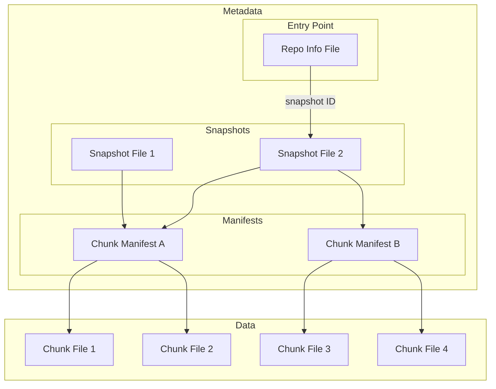

# Icechunk Specification, version 2.2

!!! Note

    This is the current Icechunk specification (spec version 2.2), used by Icechunk 2.4.0 and higher. For the previous on-disk formats, see [spec version 2.1](./spec-v2-1.md), [spec version 2](./spec-v2.md), and [spec version 1](./spec-v1.md). See [Changes from spec version 2.1 to 2.2](#changes-from-spec-version-21-to-22) for a summary of what changed.

!!! Note

    The key words "MUST", "MUST NOT", "REQUIRED", "SHALL", "SHALL NOT", "SHOULD", "SHOULD NOT", "RECOMMENDED", "MAY", and "OPTIONAL" in this document are to be interpreted as described in [RFC 2119](https://www.rfc-editor.org/rfc/rfc2119.html).

    Sections marked **"For implementers"** are non-normative guidance for anyone writing a conforming implementation. They do not define the on-disk format.

    Comments within the inline flatbuffers definitions are part of the normative specification.

## Introduction

The Icechunk specification is a storage specification for [Zarr](https://zarr-specs.readthedocs.io/en/latest/specs.html) data.
Icechunk is inspired by Apache Iceberg and borrows many concepts and ideas from the [Iceberg Spec](https://iceberg.apache.org/spec/#version-2-row-level-deletes).

This specification describes a single Icechunk **repository**.
A repository is defined as a Zarr store containing one or more [Arrays](https://zarr-specs.readthedocs.io/en/latest/v3/core/index.html#array) and [Groups](https://zarr-specs.readthedocs.io/en/latest/v3/core/index.html#group).
The most common scenario is for a repository to contain a single Zarr group with multiple arrays, each corresponding to different physical variables but sharing common spatiotemporal coordinates.
However, formally a repository can be any valid Zarr hierarchy, from a single Array to a deeply nested structure of Groups and Arrays.
Users of Icechunk should aim to scope their repository only to related arrays and groups that require consistent transactional updates.

Icechunk defines a series of interconnected metadata and data files that together comprise the format.
All the data and metadata for a repository are stored in a directory in object storage or file storage.

## Goals

The goals of the specification are as follows:

1. **Object storage** - the format is designed around the consistency features and performance characteristics available in modern cloud object storage. No external database or catalog is required.
1. **Serializable isolation** - Reads will be isolated from concurrent writes and always use a committed snapshot of a repository. Writes to repositories will be committed atomically and will not be partially visible. Readers will not acquire locks.
1. **Time travel** - Previous snapshots of a repository remain accessible after new ones have been written.
1. **Chunk sharding and references** - Chunk storage is decoupled from specific file names. Multiple chunks can be packed into a single object (sharding). Zarr-compatible chunks within other file formats (e.g. HDF5, NetCDF) can be referenced.
1. **Schema Evolution** - Arrays and Groups can be added and removed from the hierarchy with minimal overhead.

### Non Goals

1. **Low Latency** - Icechunk is designed to support analytical workloads for large repositories. We accept that the extra layers of metadata files and indirection will introduce additional cold-start latency compared to regular Zarr.
1. **No Catalog** - The spec does not extend beyond a single repository or provide a way to organize multiple repositories into a hierarchy.
1. **Access Controls** - Access control is the responsibility of the storage medium.
The spec is not designed to enable fine-grained access restrictions (e.g. only read specific arrays) within a single repository.

### Storage Operations

Icechunk requires that the storage system support the following operations:

- **In-place write** — the storage system MUST provide strong read-after-write consistency. Files are not moved or altered once written.
- **Conditional create** — the storage system MUST support atomically creating a file only if it does not exist, required to initialize a repository.
- **Conditional update** — the storage system MUST support atomically updating a file only if the current version is known to the writer.
- **Conditional copy** — the storage system MUST support copying a file only if its current version is known to the writer, required to back up the repo info before each update.
- **Range reads** — the storage system SHOULD support reading a byte range within a file, required for reading chunks stored at an offset within a larger file.
- **Deletes** — the storage system SHOULD support deleting files, required for garbage collection.
- **Listing** — the storage system SHOULD support listing the files under a prefix together with their creation times, required for garbage collection.

These requirements are compatible with object stores, like S3, as well as with filesystems.

The storage system is not required to support random-access writes. Once written, all files are immutable until deleted, with one exception: the repo info file at `$ROOT/repo`, which is updated via conditional writes.

Filesystems generally lack a conditional update. Repositories that use the [filesystem layout](./spec-filesystem-layout-v1.md) store the repo info differently and update it with filesystem operations instead; see [Writer features](#writer-features).

### Consistency and Optimistic Concurrency

Icechunk achieves transactional consistency using only the limited consistency guarantees offered by object storage.
Icechunk V2.x does this entirely via careful management of creation and conditional updating of the `RepoInfo` object.
(The exact contents of the `RepoInfo` object are defined in the format specification section below.)

When a client attempts to make a change to the repository, it fetches the latest version of the repo info object and applies its changes in memory first.
The repo info object is small, so holding it in memory is inexpensive; the window of potential conflict is also very small and unrelated to the duration of the write session.
However, when updating the object in storage, the client MUST detect whether a _different session_ has updated the repo info in the interim, possibly retrying or failing the update if so.
This is an "optimistic concurrency" strategy; retries may be needed, but conflicts are expected to be infrequent.

All major object stores support a "conditional update" operation.
In other words, object stores can guard against the race condition which occurs when two sessions attempt to update the same file at the same time. Only one of those will succeed.

This mechanism is used by Icechunk on all updates.
When it tries to update the repo info object, it attempts to conditionally update this file in an atomic "all or nothing" operation.
If this succeeds, the update is successful.
If this fails (because another client updated that file since the session started), the update fails. At this point the operation is retried.

If at any point during the update attempt an incompatible change is detected, the update operation is flagged as failed, the repo is not modified, and an error is shown to the user.
Some examples of incompatible changes are:

- A commit is attempted to a branch that was deleted by other session
- A branch is reset but it was deleted by other session

### References

Similar to Git, Icechunk supports the concept of _branches_ and _tags_.
These references point to a specific snapshot of the repository.
The repo info records the parent of each snapshot, and these parent links form the snapshot history tree.
Parent links can change: expiration and garbage collection re-parent snapshots when they remove their ancestors.

- **Branches** are _mutable_ references to a snapshot.
  A repository MUST always have a branch named `main`, and it MAY have more.
  The `main` branch MUST NOT be deleted.
  After creation, branches MAY be updated to point to a different snapshot.
- **Tags** are _immutable_ references to a snapshot.
  A repository MAY contain zero or more tags.
  After creation, tags MUST NOT be updated. Tag deletion is allowed, but a new tag with the name of a deleted one MUST NOT be created.

## Specification

### Overview

Icechunk uses a series of linked metadata files to describe the state of the repository.

- **Repository info file**, also called repo info or repo object, is the entry point linking to other files, particularly to snapshot files. Every change to the repository modifies this file in some way, doing conditional updates.
- **Snapshot files** record all of the different arrays and groups in a specific snapshot of the repository, plus their metadata. A single snapshot file describes a specific version of the repo, and every new commit creates a new snapshot file. The snapshot file contains pointers to zero or more chunk manifest files.
- **Chunk manifests** store references to individual chunks. A single manifest may store references for multiple arrays or a subset of all the references for a single array. Anytime a commit is made which writes new chunks, a new manifest file is also written.
- **Chunk files** store the actual compressed chunk data, potentially containing data for multiple chunks in a single file (i.e. a shard).
- **Transaction log files**, an overview of the operations executed during a session, used for rebase and diffs.

!!! tip "For implementers: read path"
    1. Read `$ROOT/repo` → parse repo info → look up branch → get snapshot id
    2. Read `$ROOT/snapshots/{id}` → parse snapshot → list nodes
    3. For each array node, inspect its `ManifestRef` list → get manifest ids and extents
    4. Read `$ROOT/manifests/{id}` → parse manifest → look up `ChunkRef` by coordinates
    5. Fetch chunk data: inline from the manifest, from `$ROOT/chunks/{chunk_id}`, or from a virtual URL

When reading from a repository, the client opens the repo info file to obtain a pointer to the relevant snapshot file.
The client then reads the snapshot file to determine the structure and hierarchy of the repository.
When fetching data from an array, the client first examines the chunk manifest file(s) for that array and finally fetches the chunks referenced therein.

When writing a new repository snapshot, the client first writes a new set of chunks and chunk manifests, and then generates a new snapshot file.
Finally, to commit the transaction, it updates the repo info file using an atomic conditional update operation.
This operation may fail if a different client has already committed the next snapshot.
In this case, the client may attempt to resolve the conflicts and retry the commit.



### File Layout

All data and metadata files MUST be stored within a root directory using the following directory structure.

- `$ROOT` base URI (s3, gcs, local directory, etc.)
- `$ROOT/repo` repo info file, entry point for all operations
- `$ROOT/snapshots/` snapshot files
- `$ROOT/manifests/` chunk manifests
- `$ROOT/transactions/` transaction log files
- `$ROOT/chunks/` chunks
- `$ROOT/overwritten/` old versions of the repo info object, used as backup and to maintain the ops log
- `$ROOT/repo.d/` versions of the repo info, only in repositories that use the [filesystem layout](./spec-filesystem-layout-v1.md)

Implementations SHOULD NOT create entries in `$ROOT` other than the ones listed above and those defined by the filesystem layout. [Garbage collection](#garbage-collection) never deletes entries it does not recognize.

A repository [migrated from spec version 1](#repositories-migrated-from-spec-version-1) MAY also contain the spec 1 entries `$ROOT/refs/` and `$ROOT/config.yaml`. They are not used. If `$ROOT/repo` exists, the repository is a spec 2.x repository, whether or not spec 1 entries exist.

Tools that copy, move or archive a repository MUST include every entry under `$ROOT`, including entries they do not recognize. Implementations MUST NOT delete entries they do not recognize; see [Garbage collection and expiration](#garbage-collection-and-expiration).

### Common Types

The following types are defined in [`common.fbs`](https://github.com/earth-mover/icechunk/tree/main/icechunk-format/flatbuffers/common.fbs) and used throughout all flatbuffers files.

```protobuf
--8<-- "icechunk-format/flatbuffers/common.fbs:object_id_12"
```

```protobuf
--8<-- "icechunk-format/flatbuffers/common.fbs:object_id_8"
```

When used in file names and storage paths, object ids MUST be encoded using [Crockford Base32](https://www.crockford.com/base32.html), uppercase, with no padding characters. When the input bits are not a multiple of 5, zero bits are appended on the right before encoding. An `ObjectId12` (96 bits) produces 20 characters; an `ObjectId8` (64 bits) produces 13 characters. For example, the 12 bytes `0b 1c c8 d6 78 75 80 f0 e3 3a 65 34` encode to `1CECHNKREP0F1RSTCMT0`.

```protobuf
--8<-- "icechunk-format/flatbuffers/common.fbs:metadata_item"
```

#### Node Paths

Node paths identify a node's position in the repository hierarchy. They are stored as flatbuffers `string` fields.

```protobuf
--8<-- "icechunk-format/flatbuffers/common.fbs:node_path"
```

### Binary File Format

All Icechunk metadata files (repo info, snapshots, manifests, and transaction logs) share a common on-disk format. Each file consists of a binary header followed by a zstd-compressed [flatbuffers](https://github.com/google/flatbuffers) payload.

The header contains the following fields, in order:

| Field | Size | Description |
| ------- | ------ | ------------- |
| Magic bytes | 12 bytes | The UTF-8 encoding of `ICE🧊CHUNK` (`49 43 45 F0 9F A7 8A 43 48 55 4E 4B`). |
| Implementation name | 24 bytes | A left-aligned, right-space-padded UTF-8 string identifying the writing client. |
| Spec version | 1 byte | `1` for spec version 1, `2` for spec version 2.x. |
| File type | 1 byte | `1` = Snapshot, `2` = Manifest, `4` = TransactionLog, `6` = RepoInfo. |
| Compression algorithm | 1 byte | `1` = zstd. |

The remainder of the file is the flatbuffers payload, compressed with the algorithm specified in the header.

- Every file written to a spec 2.x repository MUST have spec version `2` in its header. Readers MUST decode each file according to the spec version in its own header, since a repository can contain files of both versions; see [Repositories migrated from spec version 1](#repositories-migrated-from-spec-version-1).
- File types `3` and `5` are reserved. Writers MUST NOT write file types not listed above.
- The compression algorithm MUST be `1`. The value `0` (no compression) is reserved: writers MUST NOT write it.
- The compressed payload MUST be a single zstd frame. Writers SHOULD record the decompressed size in the frame header.

The header values, like every flatbuffers enum and union in this specification, are fixed for all of spec version 2.x. Writers MUST NOT write a value or variant this specification does not define; adding one requires a new major spec version.

### Reserved Fields

The `extra` fields in the flatbuffers tables are reserved for future versions of this specification. Spec 2.2 defines no contents for them. Implementations MUST NOT write them, and readers MUST ignore them.

### File Formats

With the exception of chunk files, each type of file is encoded using [flatbuffers](https://github.com/google/flatbuffers). Chunk files have their encoding defined by the [Zarr specification](https://zarr-specs.readthedocs.io/en/latest/v3/core/index.html#chunk-encoding). Common type definitions shared across all flatbuffers files are in [`common.fbs`](https://github.com/earth-mover/icechunk/tree/main/icechunk-format/flatbuffers/common.fbs).

#### Repo Info File

The repo info file is the single entry point for an Icechunk repository and the only mutable object in a V2.x repo. It MUST be stored at `$ROOT/repo`, except in repositories that list the `filesystem-layout-v1` [writer feature](#writer-features). Those store the current repo info as described in the [filesystem layout](./spec-filesystem-layout-v1.md), and `$ROOT/repo` holds a copy of a recent version that MAY lag behind the current one. Every read operation starts by fetching this file. Every update to the repository (commits, tag creation, configuration changes) is a conditional write on this file.

The repo info file MUST use the standard [binary file format](#binary-file-format) with file type `RepoInfo`.

The full flatbuffers schema can be found in [`repo.fbs`](https://github.com/earth-mover/icechunk/tree/main/icechunk-format/flatbuffers/repo.fbs).

The `Repo` table is the root type:

```protobuf
--8<-- "icechunk-format/flatbuffers/repo.fbs:repo_table"
```

The `spec_version` field of the `Repo` table, inside the flatbuffers payload, is the major spec version of the repository. It is separate from the spec version byte in the [file header](#binary-file-format). In a spec 2.x repository the field MUST be `2`, the same value as the header byte. Readers MUST reject a repo info file whose `spec_version` field has any other value.

##### `Ref`

Branches and tags are both stored as `Ref` entries. The `snapshot_index` is an index into the `Repo.snapshots` list.

```protobuf
--8<-- "icechunk-format/flatbuffers/repo.fbs:ref"
```

##### `SnapshotInfo`

Each snapshot in the repository has a `SnapshotInfo` entry in the repo info file. The `parent_offset` field encodes the parent relationship as an offset within the `snapshots` list (-1 for the initial snapshot). This parent link is authoritative, and it can change: expiration and garbage collection re-parent snapshots whose ancestors they remove.

```protobuf
--8<-- "icechunk-format/flatbuffers/repo.fbs:snapshot_info"
```

The `flushed_at`, `message` and `metadata` fields repeat the values in the snapshot file, so that the history can be read without fetching snapshot files. Writers MUST copy them from the snapshot file when they add the snapshot to the repo info, and MUST NOT change them afterwards. Readers MAY use either copy.

The `pruned_ancestor_tx_logs` field, added in spec version 2.1, keeps the transaction logs of ancestors that were removed from the history. Expiration and garbage collection fill it when they re-parent a snapshot, and a commit that amends a snapshot inherits the amended snapshot's list. The list is ordered by ancestry, oldest first. Implementations MUST treat the concatenation of all these transaction logs, followed by the snapshot's own transaction log, as the full transaction history for the snapshot.

Some implementations MAY compact these transaction logs to shorten the list, so readers MUST NOT assume that each entry corresponds to a real commit.

The top-level snapshot metadata key `__icechunk` is reserved for implementations. Its value is a map whose contents are implementation-defined and informational: readers MUST NOT require it. Users MUST NOT set it, and implementations SHOULD reject user metadata that contains it.

!!! tip "For implementers"
    Icechunk writes these keys in the `__icechunk` map: `is_root` (`true` in the initial snapshot), `splitting_config` (the manifest splitting configuration, in commits that rewrite manifests) and `rebase_attempts` (the number of rebases a commit needed).

##### `Update`

The `latest_updates` list is the repository ops log: one entry per update of the repo info, newest first. It summarizes the history of the repository; it is not a complete record of every change. For example, branches and tags deleted by expiration have no entries of their own. When the list exceeds its size limit, older entries are accessible via the `repo_before_updates` linked list of previous repo info files stored under `overwritten/`.

```protobuf
--8<-- "icechunk-format/flatbuffers/repo.fbs:update"
```

```protobuf
--8<-- "icechunk-format/flatbuffers/repo.fbs:update_type_union"
```

```protobuf
--8<-- "icechunk-format/flatbuffers/repo.fbs:update_types"
```

Every update of the repo info MUST add exactly one entry at the front of `latest_updates`, of the type that describes the update. Creating a repository writes `RepoInitializedUpdate` as the only entry. Migrating a repository from spec 1 writes `RepoMigratedUpdate` as the newest entry, and MAY add older entries synthesized from the spec 1 history.

| Update | Entry |
| --- | --- |
| Commit to a branch | `NewCommitUpdate` |
| Amended commit | `CommitAmendedUpdate` |
| Snapshot written without moving a branch | `NewDetachedSnapshotUpdate` |
| Branch created, reset or deleted | `BranchCreatedUpdate`, `BranchResetUpdate`, `BranchDeletedUpdate` |
| Tag created or deleted | `TagCreatedUpdate`, `TagDeletedUpdate` |
| `Repo.config` changed | `ConfigChangedUpdate` |
| `Repo.metadata` changed | `MetadataChangedUpdate` |
| Status changed | `RepoStatusChangedUpdate` |
| [Writer features](#writer-features) added or removed, including conversions between layouts | `RepoStatusChangedUpdate` |
| Feature flag changed | `FeatureFlagChangedUpdate` |
| Expiration | `ExpirationRanUpdate` |
| Garbage collection | `GCRanUpdate` |

The rules for the ops log are:

- Before replacing the repo info, an update backs it up to `overwritten/`, and sets the backup's name as the `backup_path` of the entry that was newest. The new entry has no `backup_path`. See [Updates to the repo info file](#updates-to-the-repo-info-file).
- The new entry's `updated_at` MUST be strictly greater than that of the entry that was newest before the update.
- `backup_path` and `repo_before_updates` are bare names relative to `overwritten/`, such as `repo.30729294865234.S0CHS5WSF158RN937BP0`.
- Writers choose the number of entries kept in each file, the _page size_. They SHOULD use the configured `num_updates_per_repo_info_file`, see [Configuration](#configuration), or 1,000 when it is not configured. When the list grows beyond the page size, a writer drops the older entries, starting at an entry that has a `backup_path`, and sets `repo_before_updates` to that `backup_path`. Otherwise it MUST copy `repo_before_updates` unchanged.
- Entries without a `backup_path` cannot start the dropped part, so they stay in the file. The entries synthesized by a migration from spec 1 have no `backup_path` and no backup, so a migrated repo info can hold more entries than the page size.

Readers MUST NOT depend on the page size.

##### `RepoStatus`

```protobuf
--8<-- "icechunk-format/flatbuffers/repo.fbs:repo_status"
```

```protobuf
--8<-- "icechunk-format/flatbuffers/repo.fbs:repo_availability"
```

<!-- DRAFT: until repo.fbs gains the field, the 2.2 addition to RepoStatus is:

    // Spec 2.2. The repository's own status, present exactly when
    // Repo.writer_features is non-empty. The enclosing status is then
    // the read-only gate shown to implementations that predate writer features.
    underlying: RepoStatus;
-->

The status says which operations implementations may perform on the repository:

- `Online`: reads and modifications.
- `ReadOnly`: reads only. Implementations MUST NOT modify the repository, except to change its status.
- `Offline`: reserved. Implementations MUST NOT write it. Implementations of spec 2.2 that find it MUST treat it as not `Online`: no modifications, except to change the status. Icechunk libraries up to 2.3 read it as `Online`.

When `Repo.writer_features` is non-empty, `status` is a **gate** for implementations that predate writer features, and the repository's own status is in `status.underlying`:

- `status.underlying` MUST be present, and MUST NOT itself have an `underlying`.
- `status.availability` MUST be `ReadOnly`, whatever the underlying availability.
- `status.limited_availability_reason` MUST name the writer features and the oldest Icechunk version that implements all of them, and MUST tell users not to change the status with older versions, for example "do not change the status with Icechunk older than 2.4". The underlying reason, if any, follows.
- `status.set_at` MUST equal `status.underlying.set_at`.

When `Repo.writer_features` is empty, `status.underlying` MUST be absent. Implementations of spec 2.2 or later MUST use `status.underlying`, when present, as the status of the repository, and change the status by changing `status.underlying`.

A repo info with a non-empty `Repo.writer_features` and no `status.underlying`, or with a `status.underlying` and no writer features, is malformed. Implementations MUST treat it as a format error when modifying the repository, and MAY still read it.

!!! tip "For implementers"
    Icechunk libraries 2.0 to 2.3 refuse to modify a repository with writer features, because they see its status as `ReadOnly`. Their error shows the reason, which names the features and the version required. They can still read the repository.

##### Writer features

<!-- DRAFT: until repo.fbs gains the field, the 2.2 addition to Repo is:

    // Spec 2.2. Names of the writer features this repository uses.
    // MUST be sorted in ascending UTF-8 byte order, without duplicates.
    // Null when the repository uses none; an empty vector is never written.
    writer_features: [string];
-->

A _writer feature_ is a format feature that an implementation must implement to modify a repository without damaging it. `Repo.writer_features` lists the ones a repository uses.

- An implementation MUST NOT modify a repository that lists a writer feature it does not implement. It MUST report the names of the features it lacks.
- Each feature's definition says what implementing it requires, which can depend on the storage.
- Writer features never prevent reads. An implementation that does not implement a listed feature can still read the repository.
- When rewriting the repo info, implementations MUST copy `writer_features` unchanged, except in the update that adds or removes a feature.
- The update that first writes data requiring a feature MUST add the feature. A feature MAY be removed only by an update that leaves no data requiring it.
- Adding the first feature turns on the [status gate](#repostatus), and removing the last one turns it off.
- The update that adds or removes a feature writes a `RepoStatusChangedUpdate` ops log entry.

Names defined by this specification use only lowercase ASCII letters, digits and `-`, and end in a version suffix `-v<n>`. Names that contain `.` are reserved for features defined outside this specification, which a later version may allow. Implementations MUST NOT write names that the specification they implement does not define, and MUST treat every name they do not recognize as a feature they do not implement.

This specification defines these writer features:

| Name | Meaning | First implemented in |
| --- | --- | --- |
| `filesystem-layout-v1` | The repo info is stored as described in the [filesystem layout, version 1](./spec-filesystem-layout-v1.md). | Icechunk 2.4.0 |

##### Feature flags

Feature flags let users disable operations on a repository. A flag is enabled if its id is in `Repo.enabled_feature_flags`, disabled if its id is only in `Repo.disabled_feature_flags`, and at its default otherwise. An id in both lists is enabled.

| Id | Name | Default | Enforced from |
| --- | --- | --- | --- |
| `1` | `commit` | enabled | Icechunk 2.4.0 |
| `2` | `amend` | enabled | Icechunk 2.4.0 |
| `3` | `move_node` | enabled | Icechunk 2.0.0 |
| `4` | `create_tag` | enabled | Icechunk 2.0.0 |
| `5` | `delete_tag` | enabled | Icechunk 2.0.0 |
| `6` | `rebase` | enabled | Icechunk 2.4.0 |
| `7` | `create_new_nodes` | enabled | Icechunk 2.4.0 |
| `8` | `delete_nodes` | enabled | Icechunk 2.4.0 |
| `9` | `update_chunks` | enabled | Icechunk 2.4.0 |
| `10` | `update_array_metadata` | enabled | Icechunk 2.4.0 |
| `11` | `update_group_metadata` | enabled | Icechunk 2.4.0 |
| `12` | `create_branch` | enabled | Icechunk 2.4.0 |
| `13` | `delete_branch` | enabled | Icechunk 2.4.0 |
| `14` | `reset_branch` | enabled | Icechunk 2.4.0 |
| `15` | `garbage_collection` | enabled | Icechunk 2.4.0 |
| `16` | `expiration` | enabled | Icechunk 2.4.0 |
| `17` | reserved | | |
| `18` | `update_config` | enabled | Icechunk 2.4.0 |
| `19` | `set_default_commit_metadata` | enabled | Icechunk 2.4.0 |
| `20` | `update_repository_metadata` | enabled | Icechunk 2.4.0 |
| `21` | `rewrite_manifests` | enabled | Icechunk 2.4.0 |

- Implementations MUST NOT perform an operation whose flag is disabled. The check is made against the repo info the update replaces.
- A flag changes only by an update with a `FeatureFlagChangedUpdate` entry. Every other update MUST copy both lists unchanged.
- Later 2.x versions of this specification MAY define new ids. Implementations MUST ignore ids they do not recognize, and writers MUST copy them unchanged. Writers MUST NOT add ids that the specification they implement does not define.

Implementations that do not recognize a flag id do not enforce its flag. Icechunk libraries older than the version in the table ignore the flag, so disabling it does not stop them. Setting the status to `ReadOnly` stops every Icechunk 2.x library.

##### Configuration

`Repo.config` holds the repository configuration as a [FlexBuffers](https://flatbuffers.dev/flexbuffers.html) map. An absent `config` means the default configuration.

- Writers MUST copy `config` byte for byte, unless the update intends to change the configuration, which it records with a `ConfigChangedUpdate` entry.
- The configuration evolves additively within spec 2.x.
- A key that is absent or null takes its default value. Readers MUST ignore keys they do not know.
- Readers MUST NOT fail to open a repository because of implementation-defined configuration they cannot decode.
- Writers that change the configuration MUST keep the keys they do not recognize.

##### Updates to the repo info file

The repo info object is the only mutable object in an Icechunk repo. Before a client attempts to overwrite it they MUST copy it to the `overwritten` prefix in the repo. The copy MUST hold the version of the repo info the client read. The new repo info records the copy's name as the `backup_path` of the entry that was newest before the update, see [`Update`](#update). The copy MUST be stored with a name composed of:

- The literal `repo.`
- The number of milliseconds from the current time to `3000-01-01T00:00:00Z`, that is, 32503680000000 minus the current Unix time in milliseconds, in decimal, zero-padded to 14 digits. This gives a "last one first" ordering when listing the prefix, but readers MUST NOT depend on it.
- The literal `.`
- 12 random bytes encoded as Crockford base 32 (20 characters).

for example:

```
repo.30729294865234.S0CHS5WSF158RN937BP0
```

These backups keep every earlier version of the repo info. They hold the ops log, and they let users inspect or restore an earlier version by hand. The `Repo.latest_updates` list holds recent operations, but its size is bounded. When the list overflows, older entries are dropped from the current repo info file. The `Repo.repo_before_updates` field names a backup file (in `overwritten/`) whose `latest_updates` list continues the ops log, and which has its own `repo_before_updates` pointer, forming a linked list of repo info files that together contain the complete ops log history.

#### Snapshot Files

A snapshot file fully describes the state of a repository at a given commit — all arrays, groups, and their metadata. The file name is the Crockford base 32 encoding of the snapshot's 12-byte id, stored under the `snapshots/` prefix. For example, the initial snapshot has id bytes `0b 1c c8 d6 78 75 80 f0 e3 3a 65 34` and is stored at `snapshots/1CECHNKREP0F1RSTCMT0`.

The snapshot file MUST use the standard [binary file format](#binary-file-format) with file type `Snapshot`.

The full flatbuffers schema can be found in [`snapshot.fbs`](https://github.com/earth-mover/icechunk/tree/main/icechunk-format/flatbuffers/snapshot.fbs).

The `Snapshot` table is the root type:

```protobuf
--8<-- "icechunk-format/flatbuffers/snapshot.fbs:snapshot_table"
```

##### `NodeSnapshot`

```protobuf
--8<-- "icechunk-format/flatbuffers/snapshot.fbs:node_snapshot"
```

```protobuf
--8<-- "icechunk-format/flatbuffers/snapshot.fbs:node_data"
```

##### `ArrayNodeData`

Array nodes carry shape information and pointers to their chunk manifests. The `manifests` list connects a snapshot to the manifest files that hold the array's chunk references.

```protobuf
--8<-- "icechunk-format/flatbuffers/snapshot.fbs:array_node_data"
```

```protobuf
--8<-- "icechunk-format/flatbuffers/snapshot.fbs:dimension_shape"
```

```protobuf
--8<-- "icechunk-format/flatbuffers/snapshot.fbs:dimension_shape_v2"
```

```protobuf
--8<-- "icechunk-format/flatbuffers/snapshot.fbs:dimension_name"
```

##### `ManifestRef`

Each `ManifestRef` identifies a manifest file and the region of the array's chunk grid it covers. Together, the `manifests` list on an `ArrayNodeData` forms a complete map of where all chunk references for that array can be found.

```protobuf
--8<-- "icechunk-format/flatbuffers/snapshot.fbs:chunk_index_range"
```

```protobuf
--8<-- "icechunk-format/flatbuffers/snapshot.fbs:manifest_ref"
```

##### `ManifestFileInfo`

The snapshot's `manifest_files` / `manifest_files_v2` lists provide summary metadata about every manifest file referenced by the snapshot. These are separate from the per-array `ManifestRef` pointers — they describe the manifest files themselves rather than which chunks they cover. The set of manifest ids in the list MUST equal the set of manifest ids in the `ManifestRef`s of the snapshot's nodes. Snapshot files with spec version `2` in their header use `manifest_files_v2`; snapshot files with spec version `1`, including those in [migrated repositories](#repositories-migrated-from-spec-version-1), use `manifest_files`.

```protobuf
--8<-- "icechunk-format/flatbuffers/snapshot.fbs:manifest_file_info"
```

```protobuf
--8<-- "icechunk-format/flatbuffers/snapshot.fbs:manifest_file_info_v2"
```

#### Chunk Manifest Files

A chunk manifest file stores chunk references — mappings from a chunk's coordinates in an array's chunk grid to the location of the chunk's data. Chunk references from multiple arrays can be stored in the same manifest, and a single array's chunks can be spread across multiple manifests. The file name is the Crockford base 32 encoding of the manifest's 12-byte id, stored under the `manifests/` prefix.

The manifest file MUST use the standard [binary file format](#binary-file-format) with file type `Manifest`.

The full flatbuffers schema can be found in [`manifest.fbs`](https://github.com/earth-mover/icechunk/tree/main/icechunk-format/flatbuffers/manifest.fbs).

The `Manifest` table is the root type:

```protobuf
--8<-- "icechunk-format/flatbuffers/manifest.fbs:manifest_table"
```

##### `ArrayManifest`

```protobuf
--8<-- "icechunk-format/flatbuffers/manifest.fbs:array_manifest"
```

##### `ChunkRef`

Chunk references come in three types, encoded in the same flatbuffers table using optional fields:

- **Native** — points to a chunk file within the repository's storage, identified by `chunk_id`. The `offset` and `length` fields locate the chunk within the file.
- **Inline** — the chunk data is embedded directly in the `inline` field. Used for very small chunks (e.g. coordinate arrays).
- **Virtual** — points to a region of a file outside the repository (e.g. a chunk inside a NetCDF file), identified by `location` (or `compressed_location`) plus `offset` and `length`.

```protobuf
--8<-- "icechunk-format/flatbuffers/manifest.fbs:chunk_ref"
```

When virtual chunk locations are compressed, a zstd dictionary is computed globally across the whole manifest. Individual locations are stored in the `compressed_location` field of each `ChunkRef`, and the dictionary is stored in the manifest's `location_dictionary` field. A `compressed_location` in a manifest whose `compression_algorithm` is not `1`, or that has no `location_dictionary`, is an error. Readers MUST support decompressed locations of up to 1024 bytes. Writers MUST store longer locations in `location`. A manifest MAY mix compressed and uncompressed locations.

##### Virtual chunk locations

A virtual chunk location is one of:

- An **absolute URL**, `<scheme>://<authority>/<key>`, for example `s3://bucket/path/file.nc`.
- A **relative location**, `vcc://<name>/<relative-path>`, where `<name>` is the name of a virtual chunk container in the repository's [configuration](#configuration). `<name>` MUST be non-empty and MUST NOT contain `/`.

Readers resolve a relative location by finding the container whose `name` is `<name>` and concatenating its `url_prefix` and `<relative-path>`. A relative location whose container is not in the configuration cannot be read.

!!! tip "For implementers"
    Relative locations let a repository move its virtual data: changing a container's `url_prefix` changes where all of its chunks are read from.

!!! tip "For implementers"
    Icechunk writes URL schemes in lowercase and uses keys verbatim: repeated `/` and `.` or `..` segments are part of the key, and characters reserved in URLs, such as `?`, `#` and `%`, are percent-encoded. `file` URLs are the exception: Icechunk normalizes them, removing `.` and `..` segments.

#### Chunk Files

Chunk files contain the binary chunks of a Zarr array, stored under the `chunks/` prefix. The file name is the Crockford base 32 encoding of the chunk's 12-byte id. Chunk encoding and compression are defined by the [Zarr specification](https://zarr-specs.readthedocs.io/en/latest/v3/core/index.html#chunk-encoding), not by Icechunk.

Icechunk permits flexibility in how chunks are arranged within files:

- One chunk per chunk file (i.e. standard Zarr)
- Multiple contiguous chunks from the same array in a single chunk file (similar to Zarr V3 shards)
- Chunks from multiple different arrays in the same file
- Other file types (e.g. NetCDF, HDF5) which contain Zarr-compatible chunks

Applications may choose to arrange chunks within files in different ways to optimize I/O patterns.

#### Transaction Log Files

A transaction log file records which nodes and chunks were modified in a given commit.
Each snapshot MUST have a corresponding transaction log file stored at `transactions/{id}`, where `{id}` is the Crockford base 32 encoding of the snapshot's id.
The initial snapshot of a repository [migrated from spec version 1](#repositories-migrated-from-spec-version-1) is the exception: it has no transaction log.
A transaction log listed in a `pruned_ancestor_tx_logs` is stored the same way, under the id listed there.

A transaction log listed in a `pruned_ancestor_tx_logs` can be missing, because garbage collection in implementations of spec version 2.0 did not keep these logs. Readers MUST handle this: operations that need the complete history of a snapshot to be correct, such as rebase, MUST fail; operations that only report it, such as diffs, MAY proceed and SHOULD report that the result is incomplete.

The transaction log file MUST use the standard [binary file format](#binary-file-format) with file type `TransactionLog`.

!!! tip "For implementers"
    Transaction logs are not needed to read data from a repository — they exist to support
    conflict detection during rebase and to compute diffs between commits.
    A read-only implementation can safely omit transaction log support.

The full flatbuffers schema can be found in [`transaction_log.fbs`](https://github.com/earth-mover/icechunk/tree/main/icechunk-format/flatbuffers/transaction_log.fbs).

The `TransactionLog` table is the root type:

```protobuf
--8<-- "icechunk-format/flatbuffers/transaction_log.fbs:transaction_log"
```

!!! tip "For implementers"
    The `extra` fields are reserved for this specification, see [Reserved fields](#reserved-fields).

##### `ArrayUpdatedChunks`

```protobuf
--8<-- "icechunk-format/flatbuffers/transaction_log.fbs:chunk_indices"
```

```protobuf
--8<-- "icechunk-format/flatbuffers/transaction_log.fbs:array_updated_chunks"
```

##### `MoveOperation`

```protobuf
--8<-- "icechunk-format/flatbuffers/transaction_log.fbs:move_operation"
```

### Repositories Migrated from Spec Version 1

A spec 1 repository is migrated to spec 2.x by writing a repo info file. Migration does not rewrite other files, so a migrated repository contains:

- snapshot, manifest and transaction log files with spec version `1` in their header, written before the migration, and files with spec version `2`, written after it. Readers MUST decode each file according to its own header. Files with spec version `1` follow the [spec version 1](./spec-v1.md) format.
- snapshot files with a `parent_id`. Readers MUST ignore it: the parent recorded in the repo info is authoritative, and expiration or garbage collection may have changed it.
- no transaction log for the initial snapshot.
- possibly the unused spec 1 entries `$ROOT/refs/` and `$ROOT/config.yaml`.

The repo info of a migrated repository has spec version `2` in its header and in `Repo.spec_version`.

## Algorithms

### Modify a Repository

Before any modification, including commits, ref changes, configuration and metadata changes, expiration and garbage collection, an implementation MUST check, against the repo info it is about to replace:

1. that it implements every feature in `Repo.writer_features`;
1. that the repository's status is `Online`, unless the modification only changes the status, or only adds or removes writer features and keeps the status, as the [filesystem layout conversions](./spec-filesystem-layout-v1.md#conversions) do.

It MUST fail the modification otherwise.

### Initialize New Repository

A new repository is initialized by creating a new empty snapshot file, a new empty transaction log file,
and finally creating the repo info file that includes a `main` branch pointing to the new snapshot.
The first snapshot has a well known id, that encodes to a file name: `1CECHNKREP0F1RSTCMT0`. All object ids are
encoded in paths using Crockford base 32.

- The initial snapshot MUST have no nodes and no manifests. Its message SHOULD be `Repository initialized`.
- The initial transaction log MUST have all lists empty.
- The repo info MUST have a single snapshot, the initial one, a single branch, `main`, pointing to it, and a single ops log entry, `RepoInitializedUpdate`. Its `config` MAY be absent.
- Its status MUST be `Online`. A repository created in the [filesystem layout](./spec-filesystem-layout-v1.md) lists `filesystem-layout-v1` in `Repo.writer_features`, so its status is the [gate](#repostatus), with `underlying` `Online`. Creating a repository is not a change of writer features: `RepoInitializedUpdate` is still the only entry.

### Read from Repository

#### From Snapshot ID

If the specific snapshot ID is known, a client can open it directly in read only mode.

1. Use the specified snapshot ID to fetch the snapshot file.
1. Inspect the snapshot to find the relevant manifest or manifests.
1. Fetch the relevant manifests and the desired chunks pointed by them.

#### From Branch

Usually, a client will want to read from the latest branch (e.g. `main`).

1. Read the repo info object in `repo` path.
1. Find the snapshot ID currently pointed by the `main` branch by scanning the `branches` field.
1. Use the snapshot ID to fetch the snapshot file.
1. Fetch the relevant manifests and the desired chunks pointed by them.

#### From Tag

1. Read the repo info object in `repo` path.
1. Find the snapshot ID currently pointed by the tag by scanning the `tags` field.
1. Use the snapshot ID to fetch the snapshot file.
1. Fetch the relevant manifests and the desired chunks pointed by them.

### Write New Snapshot

1. Open a repository at a specific branch as described above, keeping track of the parent snapshot id and branch name in the session context.
1. [optional] Write new chunk files.
1. [optional] Write new chunk manifests.
1. Write a new transaction log file summarizing all changes in the session.
1. Write a new snapshot file with the new repository hierarchy and manifest links. Its `flushed_at` MUST be strictly greater than the parent snapshot's.
1. Do conditional update to write the new repo info file that contains the new snapshot and the new pointer for the branch
    1. If successful, the commit succeeded and the branch is updated.
    1. If unsuccessful because the branch was updated since the session started, attempt to reconcile and retry the commit.
    1. If unsuccessful because there was some other previous update to the repo info file, read the file again and retry

### Garbage Collection and Expiration

Implementations MAY remove snapshots from the repo info (expiration) and delete objects that the repo info no longer references (garbage collection). Both modify the repository, so the checks in [Modify a repository](#modify-a-repository) apply.

At every point during and after these operations, every object referenced from the current repo info MUST exist. For every `SnapshotInfo` in `Repo.snapshots`, that is:

- its snapshot file;
- its transaction log file;
- every transaction log file listed in its `pruned_ancestor_tx_logs`;
- every manifest file its snapshot file references, and every chunk file those manifests reference.

Both operations update the repo info with a conditional update, like any other update. If the repo info changed since the operation read it, the operation MUST either recompute its decisions from the new repo info, or fail with an error that says the repository changed during the operation.

#### Removing snapshots from the history

Expiration and garbage collection remove `SnapshotInfo` entries from `Repo.snapshots`.

An operation MUST NOT remove the initial snapshot, or a snapshot that a ref in the resulting repo info points to. So `Repo.snapshots` can shrink, and the parent links in the repo info change.

#### Expiration

Expiration removes from the history the snapshots committed before a cutoff time. It only rewrites the repo info, with an `ExpirationRanUpdate` entry, and never deletes files.

- It removes snapshots whose `flushed_at` is earlier than the cutoff, except snapshots without a parent and snapshots a remaining ref points to.
- It MAY also delete branches other than `main`, and tags, that point to such snapshots, and then remove those snapshots too. Deleted tags MUST be added to `Repo.deleted_tags`. These deletions have no ops log entries of their own.
- Surviving snapshots MUST be re-parented as needed.

#### Garbage collection

Garbage collection deletes files that the repository no longer needs, and removes from the repo info the snapshots that are no longer reachable. It decides by a cutoff time, which MUST be earlier than the start of every session that may still commit, so that the objects those sessions write are kept.

1. The _roots_ are the snapshots that refs point to, plus any snapshots the user names. Every snapshot in the ancestry of a root is reachable, and MUST be kept.
1. A snapshot in `Repo.snapshots` that is not reachable MAY be removed, only if the creation time the storage reports for its snapshot file is earlier than the cutoff. The removal rewrites the repo info with a `GCRanUpdate` entry and re-parents surviving snapshots as needed.
1. The objects to keep are the files of the snapshots that remain in the repo info, their manifests and chunks, their transaction logs, and every transaction log listed in a `pruned_ancestor_tx_logs` in the repo info.
1. GC MAY delete a file in `snapshots/`, `manifests/`, `transactions/` or `chunks/` that is not kept, only if the creation time the storage reports for it is earlier than the cutoff.

Garbage collection MUST NOT delete entries it does not recognize, in `$ROOT` or in its subdirectories, except as defined by a layout this specification describes. In `snapshots/`, `manifests/`, `transactions/` and `chunks/`, a name is recognized only if it is exactly the Crockford base 32 encoding of an object id of the right size, as defined in [Common Types](#common-types). Garbage collection MUST NOT delete anything in `overwritten/` or directly in `$ROOT`, except the leftovers that a layout defines.

### Create New Tag

A tag can be created from any snapshot.

1. Open the repository at a specific snapshot.
1. Do conditional update to write the new repo info file that contains the new tag
    1. If successful, the update succeeded and the tag is created.
    1. If unsuccessful because there was some previous update, read the file again and retry
    1. If unsuccessful because the snapshot doesn't exist, fail the update

## Changes from spec version 2.1 to 2.2

- Added writer features.
- Added the status gate.
- Defined the `filesystem-layout-v1` writer feature and the [filesystem layout, version 1](./spec-filesystem-layout-v1.md).
- Defined what modifying a repository means, and the checks required before it.
- Reserved the `Offline` status.
- Defined the feature flag ids `1` to `21`, with `17` reserved. Ids `3` to `5` were already used by Icechunk 2.0.0; the others are new.
- Added normative rules for garbage collection and expiration.
- Reserved the `extra` fields for this specification.
- Froze the flatbuffers enums and unions, and the header values, for all of spec 2.x.
- Clarified existing behavior: the header values, the repository status, the ops log and its backups, the configuration fields needed to interoperate, feature flags, relative virtual chunk locations and compressed locations, the consistency of `manifest_files_v2` and `SnapshotInfo` with the snapshot file, repository initialization, repositories migrated from spec version 1, and the cases where a transaction log is missing or lists a node more than once. These clarifications also apply to repositories written under spec versions 2 and 2.1.
- The change is backwards compatible. Every 2.x library can read a spec 2.2 repository. Libraries before 2.4.0 cannot modify a repository that lists writer features.
- The on-disk format flags repositories as version `2` for spec 2, 2.1 and 2.2.

## Changes from spec version 2 to 2.1

- Added the optional `pruned_ancestor_tx_logs` field to the `SnapshotInfo` table in the `repo` flatbuffer file.
- `pruned_ancestor_tx_logs` is populated by expiration and garbage collection, recording the transaction logs of ancestor commits that were removed from the repository, and inherited by amended commits.
- `pruned_ancestor_tx_logs` is an optional flatbuffers field, and a 2.1 reader treats its absence as "never expired". Icechunk 2.0.x libraries can read and write spec 2.1 repositories, but every repo info update they make removes `pruned_ancestor_tx_logs` from every snapshot, after which garbage collection may delete the transaction logs it listed. That history cannot be recovered.
- The on-disk format flags repositories as version `2` for both spec 2 and spec 2.1.

## Changes from spec version 1 to 2

- The repo info object was introduced as a single point of consistency and atomicity. This file is in the `repo` path, inside the repository tree. Many new fields are introduced in this object, such as feature flags, status, spec version and others.
- There is now a single mutable object: `repo`. Updates to this file first backup the original contents in the new `overwritten/` prefix.
- There is no longer a `refs` prefix, branches and tags are stored in the repo info object.
- A transaction id is written for the first commit that initializes the repo.
- There is no longer a `config.yaml` file, repo configuration has been moved to the repo info object.
- Snapshots no longer store its parent in the snapshot file. This information has been moved to the repo info object.
- A new `extra` field has been added in the flatbuffers of most datastructures. This allows for future expansion without a format change.
- For each dimension of each array, instead of storing the `chunk_length` in the snapshot, the `num_chunks` is now stored.
This will help with rectilinear chunk grids.
- Virtual chunk location can optionally be compressed inside the manifest.
- Transaction logs gained `moved_nodes` and `extra` fields (absent in V1 transaction logs).
